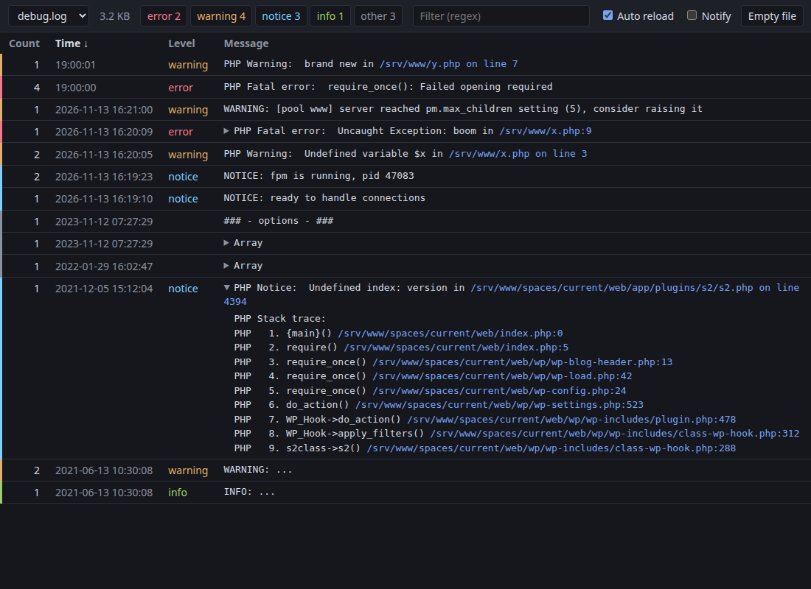

# PHP Error Log Viewer


A page for your PHP log files that groups equal errors and shows new ones as they appear. Plain PHP and JavaScript: no dependencies, no CDN, works offline.



- Groups equal messages: count, time of the last occurrence, level.
- Follows the file: every few seconds it fetches only what the log gained. New entries are counted in the tab title and, if you tick "Notify", announced by the browser while the tab is in the background.
- Reads PHP's `error_log`, the php-fpm log (its own messages, relayed worker output, the slow log) and the nginx and Apache error logs. Stack traces stay with their error.
- Sort by any column, filter by regular expression, hide levels.
- Paths with a line number open in your editor ([Linking](#linking)).
- Can empty the log file.
- Requires PHP 8.3 or later.

## Getting started

Download the single file next to your `debug.log`, or build it yourself with `php build.php` (it lands in `dist/`):

```bash
curl -LO https://github.com/schuhwerk/php-error-log-viewer/releases/latest/download/php-error-log-viewer.php
```

Or install the sources, which run as they are from `index.php`:

```bash
composer require --dev schuhwerk/php-error-log-viewer
```

Then open the file or folder in your browser, like `http://mydomain.local/php-error-log-viewer/`.

## Settings

Optional, in `php-error-log-viewer.ini` next to the viewer. If there is none, the viewer looks two folders up (for a composer install: in `vendor/`).

```ini
; One log, relative to the viewer. This is the default.
file_path = '../debug.log'
; Or several, to switch between in the page. Replaces file_path.
files[] = '../../app/debug.log'
files[] = '/var/log/php8.3-fpm.log'
files[] = '/var/log/nginx/error.log'
; See "Linking". Empty: no links.
link_template = 'vscode://file/{{path}}:{{line_number}}'
link_path_search = '/srv/www/current/'
link_path_replace = '/home/me/my-repository/'
; See "Security". Plain, or better the output of: php -r "echo password_hash('secret', PASSWORD_DEFAULT);"
password = ''
; Of a larger file only the end is read.
max_mb = 32
```

The former names `vscode_path_search` and `vscode_path_replace` still work.

The web server's user has to be able to read a log, and to write it for "Empty file". Server logs are often readable by root only.

## Security

Logs hold sensitive data, and this tool can empty them. It is meant for development environments.

- Without a `password`, only clients with a local or private address are served. Behind a reverse proxy that does not pass the client's address on (`X-Forwarded-For`), every visitor looks local: set a password there.
- With a `password`, the browser asks for it (HTTP Basic, any user name). Use HTTPS, and store a hash: the `.ini` may be readable over the web unless your server denies it.
- A client picks a log by its position in `files`, never by path.
- Other websites cannot read or empty your log through your browser: requests need a header that a foreign page cannot send, and emptying is a POST.
- Log content is inserted as text, never as HTML, and the page allows no scripts or styles but its own (Content Security Policy).

## Linking

Paths followed by a line number become links. `link_path_search` and `link_path_replace` translate a server path into a local one (a VM, a container). These are recognized:

- `/srv/www/web/app/themes/defaultspace/functions.php(605)`: get_post_card(Object(WP_Post), Array)
- ... called in `C:\foo\bar/themes/defaultspace/functions.php on line 605`
- ... and defined in `C:\foo\bar/themes/defaultspace/functions.php:63`

A [VS Code snippet](https://code.visualstudio.com/docs/editor/userdefinedsnippets) that logs with such a path:

```json
"Log to error log": {
	"prefix": "error_log",
	"body": ["error_log( \"$1\" . __FILE__ . ' on line ' . __LINE__ . \"\\n\" . print_r( $2, true ) );", "$4"],
	"description": "Log array/object to error log."
}
```

## Notifications

"Notify" asks for the browser's permission once. From then on, new entries that pass the filter and the level buttons are announced while the tab is open in the background. Browsers offer this over HTTPS or on `localhost` only. With the tab closed nothing is watched.

## Command line

```bash
php index.php [file]   # one line per group: count, level, time, first line
```

Without a file it reads the first configured one.

## Development

| File | What |
| --- | --- |
| `src/Parser.php` | Lines in, grouped entries out. All knowledge of log formats. No files, no HTTP. |
| `src/Viewer.php` | Settings, access control, the requests (`?log=<n>&from=<byte>`, `POST ?clear=<n>`, the page), the command line. |
| `src/ui.html`, `ui.css`, `ui.js` | The page. The script keeps one `state`, `poll()` merges what the server sends, `render()` draws it. |
| `index.php` | Runs the sources. |
| `build.php` | Packs all of it into `dist/php-error-log-viewer.php`. |
| `tests/run.php`, `tests/fixtures/` | The tests and one sample log per format. The server logs are excerpts from public bug reports, with addresses and hosts replaced. |

No external dependencies, for the tool as for its tests: the tests are a plain PHP script, not PHPUnit, so they run without `composer install`. Only linting needs PHP_CodeSniffer.

```bash
php tests/run.php      # or: composer test. Prints failures and one summary line. Builds too.
composer lint          # PSR-12, needs composer install
```

How an entry is recognized: it starts at a line that opens with a timestamp, and every other line continues the entry before it. Two entries are the same error when their text is equal once process ids, memory addresses and the request are removed (`Parser::NOISE`). To support another format, add a sample to `tests/fixtures/`, a check to `tests/run.php`, then extend the patterns at the top of `Parser`.
